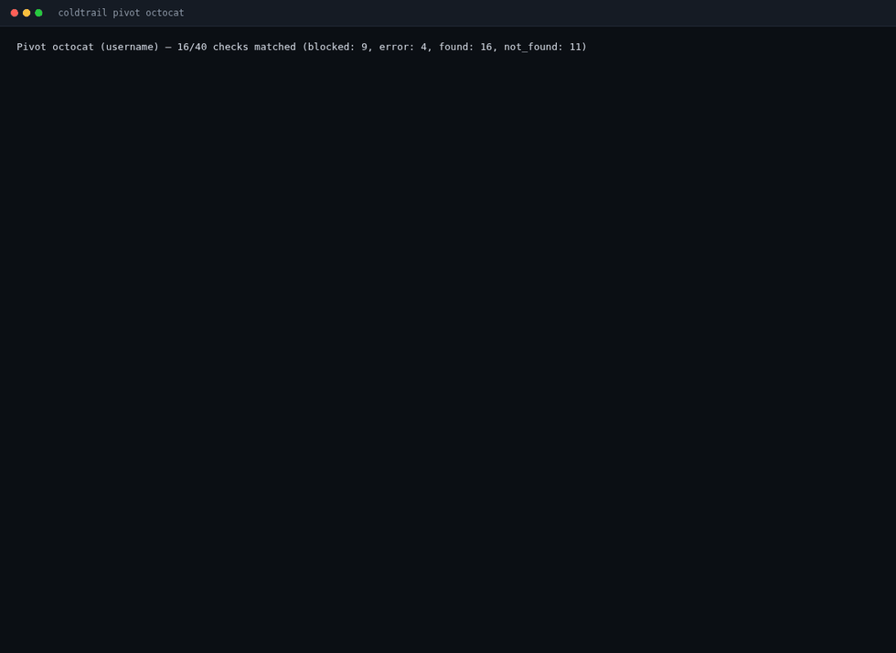
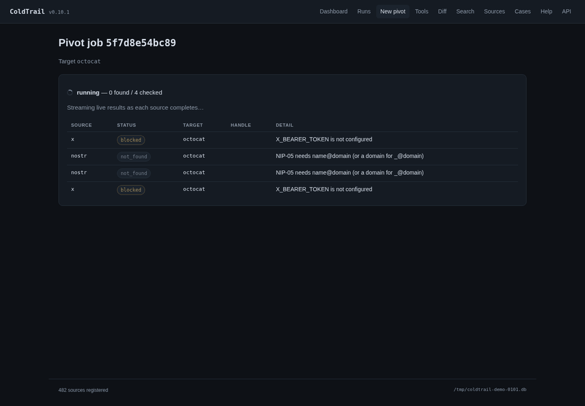
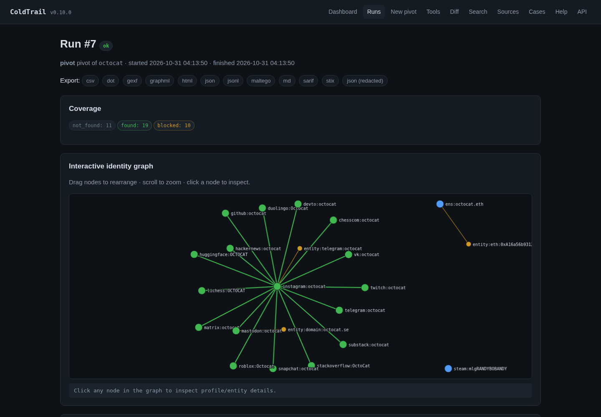
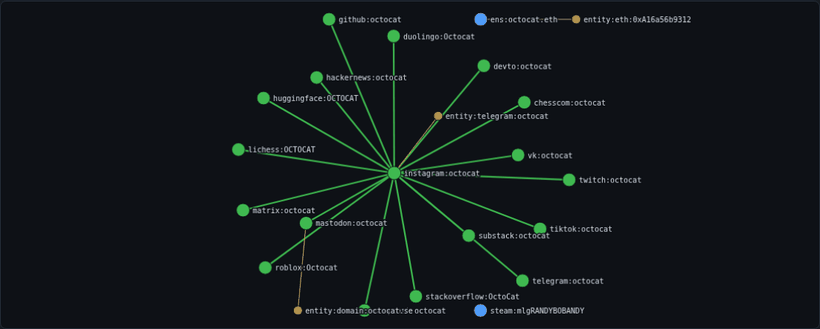
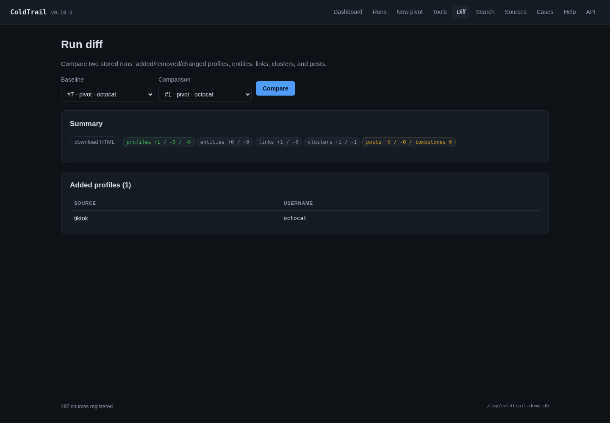
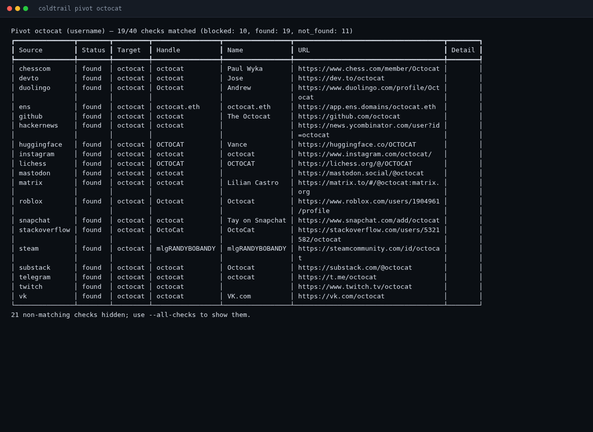

# ColdTrail

**Local-first OSINT for usernames, emails, and public profiles.** Pivot across 482 sources,
harvest profiles and posts into SQLite, correlate identities, and export evidence-grade
dossiers — from a CLI, a TUI, or a local web UI.

[](https://github.com/vezeqs/Cold-Trail/actions/workflows/ci.yml)
[](LICENSE)
[](https://www.python.org/)
[](https://vezeqs.github.io/Cold-Trail/)



*Real `coldtrail pivot octocat` output, captured by `scripts/capture_media.py`.
`octocat` is a shared handle: the 19 hits below are public accounts with that
name, not a claim that they belong to one person.*

## The problem

A username investigation usually starts as twenty browser tabs: a GitHub
profile, a Reddit account, a Mastodon handle, a paste of search results, and a
spreadsheet of "maybe the same person". Nothing is reproducible, the raw pages
disappear, and the next analyst starts over.

ColdTrail replaces the tabs with one local SQLite database and a repeatable
command. Every probe is a stored check; every profile, post, link, cluster, and
entity is queryable; every export is a file you can hash, redact, or hand to a
reviewer.

## What you get

| Capability | Details |
| --- | --- |
| **Pivot** | 482 sources (50 curated + 432 declarative sites), handle/email variants, multi-hop expansion |
| **Harvest** | Profiles, paginated posts, follow graphs, incremental cursors, profile-change history |
| **Correlate** | Additive evidence scoring, calibrated confidence, Jaro-Winkler handle similarity, clusters |
| **Investigate** | Domain/IP/phone, RDAP, DNS, crt.sh, TLS, BGP/ASN, Wayback, dorks, breach metadata |
| **Evidence** | Content-addressed SHA-256 blobs, case dossiers, tags, notes, audit log |
| **Export** | JSON, JSONL, CSV, GraphML, GEXF, DOT, HTML, Markdown, STIX 2.1, SARIF 2.1.0, Maltego |
| **Automate** | `batch` (with `--jobs`), `watch`, `recluster`, `diff`, `--json` everywhere |
| **Inspect** | `config` (effective settings + provenance), `schema` (JSON Schema contracts), `doctor` |
| **Health** | `source health --live` records per-source status and latency; shown in the web UI |

### Three interfaces, one database

- **CLI** — scriptable Typer app with grouped help and JSON/JSONL output.
- **TUI** — Textual console with dashboard, live pivot rows, browse/search, cases, tools.
- **Web** — FastAPI app with JSON API, SSE-streamed pivots, interactive identity graph,
  OSINT workbench, run diffing, case dossiers, evidence downloads, optional auth.


*The dashboard after the live `octocat` pivot: 40 checks, 20 profiles, 17
correlation links, 1 cluster, and per-source health.*

## Quickstart

```bash
git clone https://github.com/vezeqs/Cold-Trail
cd Cold-Trail
uv sync

uv run coldtrail pivot alice          # curated sources + correlation
uv run coldtrail pivot alice --web    # add the 432-site web corpus
uv run coldtrail serve --open         # local web UI at 127.0.0.1:8765
uv run coldtrail tui                  # terminal UI
```

No API keys are required for most sources. Optional keys unlock more coverage:

```bash
export GITHUB_TOKEN=...        # higher GitHub rate limits
export HIBP_API_KEY=...        # Have I Been Pwned
export EMAILREP_API_KEY=...
export HUNTER_API_KEY=...      # Hunter.io email verification
export X_BEARER_TOKEN=...      # X/Twitter API v2
export SERPER_API_KEY=...      # Google search via Serper
export BRAVE_API_KEY=...       # Brave Search API
export SEARXNG_URL=...         # self-hosted SearXNG base URL
export OPENCORPORATES_API_KEY=...
export COMPANIES_HOUSE_API_KEY=...
export OPENSANCTIONS_API_KEY=...
```

## Proof from a real run

These are not mockups. `scripts/capture_media.py` starts the web UI against a
real pivot database, drives Chromium, and writes the GIFs/PNGs plus a manifest
of their hashes.

### Live pivot streaming



*`POST /pivot` returns a job immediately; `/api/jobs/{id}/stream` replays each
check as an SSE event while the page fills in.*

### Run detail and identity graph





*Profile nodes, extracted-entity nodes, and correlation edges. The canvas runs
a force simulation; nodes are draggable and the graph is clickable.*

### Run diff



*`coldtrail diff A B` and `/diff` compare profiles, entities, links, clusters,
and posts. `--format html` / `?format=html` produces a self-contained dossier.*

### Terminal capture



*The same run in the terminal. `--all-checks` shows the blocked and not-found
checks; the default view hides them.*

## CLI at a glance

```bash
uv run coldtrail --help
uv run coldtrail config --json                    # effective settings + source
uv run coldtrail schema pivot > pivot.schema.json # validate --json output
uv run coldtrail pivot alice --json
uv run coldtrail harvest alice -s github --incremental
uv run coldtrail diff 3 4 --format html -o diff.html
uv run coldtrail export 3 --format sarif -o findings.sarif
uv run coldtrail export 3 --format stix -o bundle.json
uv run coldtrail serve --token "$(openssl rand -hex 24)"   # shared-token auth
```

`coldtrail config` is the answer to "why is it using that database / timeout /
proxy?" It reports each value, its source (`default`, `config`, `env`, `flag`),
and redacts every secret. `coldtrail schema` publishes the contracts for the
`pivot`, `run`, `diff`, `sources`, `doctor`, `config`, and `stats` payloads.

## Who it's for

- **Journalists and researchers** who need a reproducible trail from a handle or email.
- **Threat-intelligence and defensive teams** correlating public personas and exposure.
- **Brand-protection and due-diligence analysts** who need evidence, not just a list of links.
- **OSINT learners** who want one local database instead of a browser full of tabs.

Use it only for authorized research, public data, and lawful scope.

## How it compares

Based on public documentation, not a benchmark. Check each upstream project for
current features.

| | ColdTrail | Sherlock | Maigret | theHarvester | SpiderFoot | Maltego |
| --- | --- | --- | --- | --- | --- | --- |
| Username pivot | yes (482 sources) | yes | yes | partial | partial | via transforms |
| Email pivot | yes | no | partial | yes | yes | via transforms |
| Local database | SQLite | no | reports | no | SQLite | commercial graph |
| Identity correlation | yes | no | partial | no | partial | yes (manual) |
| Evidence store | yes (SHA-256) | no | no | no | partial | commercial |
| Built-in TUI | yes | no | no | no | no | no |
| Local web UI | yes | no | no | no | yes | desktop app |
| STIX/SARIF export | yes | no | partial | no | partial | yes |
| Privacy-first defaults | yes | n/a | n/a | n/a | partial | commercial |
| License | MIT | MIT | MIT | GPL | MIT | commercial |

## Performance

Network-bound and source-dependent; these are design targets and historical
measurements from the 0.5.2 release notes on a laptop:

| Scenario | Cold | Warm cache |
| --- | --- | --- |
| Curated pivot (≈50 checks) | ~4s | ~2s |
| Web corpus (≈432 checks) | ~22s | ~15s |

Reproduce locally:

```bash
time uv run coldtrail pivot alice --web --no-save
time uv run coldtrail pivot alice --no-save          # warm cache
```

The 2026-10-30 audit run of `pivot octocat` (curated sources) completed 40
checks with 19 found, 10 blocked, and 11 not found. Blocked sources are reported
as blocked, not silently dropped.

## Privacy first

ColdTrail is designed to keep investigations on your machine.

- **No telemetry.** No analytics, crash reporting, update checks, or phone-home. The only
  outbound requests are the sources and tools you explicitly run. `doctor --offline` skips
  even its reachability probe.
- **Local storage, owner-only from creation.** The SQLite file, WAL/SHM, and evidence blobs
  are created `0600` under `umask(0o077)`; evidence directories are `0700`. There is no cloud
  backend.
- **Raw bodies are opt-in.** Normal runs do not retain raw HTTP responses. Use `--raw` only
  when you need replay or contract fixtures.
- **No third-party images by default.** Avatar hashing (`--avatar-hash`) downloads profile
  images from source platforms, so it is off unless you ask for it.
- **Sensitive identifiers stay out of indexes.** Email targets are SHA-256 hashed in
  cache/raw keys, and API keys are never written to those keys. HIBP, EmailRep, and Hunter
  use auth headers; Shodan's key is sent over TLS and redacted locally.
- **Tor without DNS leaks.** `--tor` uses `socks5h://127.0.0.1:9050` (remote DNS).
  `--proxy` supports HTTP/SOCKS proxies.
- **Redirects are re-validated.** A public URL may not redirect into loopback, link-local,
  `.local`, or a literal private address unless `--allow-private-targets` is explicit.
- **Web UI is local and locked down.** Binds `127.0.0.1`; non-loopback binds require
  `--token` (or an explicit `--allow-unauthenticated`); cookies are HMAC-derived; CSP,
  `Referrer-Policy: no-referrer`, `Cache-Control: no-store`, and no third-party assets.
  `/healthz` returns a fixed `database unavailable` detail, never exception text.
- **Redaction and encryption.** Exports support `--redact`; encrypted exports use
  PBKDF2 + Fernet.
- **Retention.** `--retention-days N` or `prune --days N` removes old runs, raw/cache rows,
  audit entries, and orphan evidence blobs.
- **Breach data is metadata-only.** HIBP/HudsonRock/LeakCheck report exposure; Pwned
  Passwords uses k-anonymity and never sends the password or full hash.

**Limits:** every source you probe receives the target — that is inherent to OSINT. The
database is not encrypted at rest by default, so use full-disk encryption on shared
machines. `--raw` and the local HTTP cache can retain third-party content. See
[SECURITY.md](SECURITY.md) and the [privacy page](docs/privacy.html).

## Limits and honest caveats

- **Public data only.** ColdTrail does not log in, bypass paywalls, or scrape
  private content. Sources that require auth or block non-browser clients are
  reported as `blocked`.
- **Coverage varies by platform.** A 200 page is not proof of a profile; the
  declarative engine rejects challenge, landing, consent, and not-found titles,
  but platforms change markup without notice. Contract fixtures catch drift for
  the curated sources.
- **Correlation is probabilistic.** Additive evidence is not proof of identity.
  Shared handles, default avatars, and boilerplate bios produce false positives;
  read the reasons, not just the score. `octocat` in this README is a shared
  handle used to demonstrate the mechanics.
- **Timezone inference is ambiguous.** Posting-hour analysis cannot distinguish
  UTC+13 from UTC-11; the value is a hint.
- **DNS rebinding is a known TOCTOU.** Host validation resolves once; a pinned-IP
  transport is future work. Keep the web UI on loopback or behind an
  authenticating proxy.
- **Correlation is O(n²).** A full 482-source pivot evaluates ~116k pairs; network
  time still dominates.
- **The TUI test suite is pinned to Textual 2.x.** Dependabot PR #15 (Textual 8)
  is blocked on the `Static.renderable` test helper.
- **No encryption at rest by default.** Use full-disk encryption or `--encrypt`
  for transport.

## External tools

Already installed tools are detected and can be imported into the same database:

```bash
uv run coldtrail integrations                  # status + install hints
uv run coldtrail websearch 'site:example.com admin'   # search-engine query
uv run coldtrail company "Acme Ltd"            # corporate/sanctions lookup
uv run coldtrail run nuclei example.com --json # import findings
uv run coldtrail ingest spiderfoot.json        # auto-detect format
```

| Category | Tools |
| --- | --- |
| Username | `sherlock`, `maigret`, `naminter` (WhatsMyName), `social-analyzer`, `blackbird` |
| Email | `holehe`, `h8mail`, `ghunt` |
| Social | `instaloader` (Instagram), `twscrape` (X/Twitter) |
| Infrastructure | `theHarvester`, `subfinder`, `amass`, `assetfinder`, `httpx`, `nuclei`, `naabu`, `katana`, `dnsx`, `gau`, `whois`, `dig`, `nmap` |
| Phone / secrets | `phoneinfoga`, `gitleaks`, `trufflehog` |
| Files/media | `exiftool`, `yt-dlp` |
| Import-only | SpiderFoot JSON, Maltego CSV, theHarvester JSON, generic JSON |

Every runner uses an argument vector (never a shell) and rejects option-like targets.

## Verify these claims

```bash
uv run pytest                       # offline suite (respx/TestClient/Textual pilot)
uv run pytest --cov=coldtrail       # coverage floor: 73%
uv run ruff check . && uv run ruff format --check .
uv run mypy                         # typed core + store gate
uv run coldtrail doctor --offline
uv run coldtrail config --json
uv run coldtrail schema --list
uv run coldtrail source verify -s github   # replay a recorded contract offline
```

Regenerate the README media (needs network for the live pivot and Playwright's
Chromium):

```bash
uv run --with playwright python scripts/capture_media.py
uv run pytest tests/test_media_manifest.py
```

`tests/test_media_manifest.py` fails when the images, their hashes, or the UI
code they show fall out of sync.

## Documentation

- **Site:** [docs/index.html](docs/index.html) (GitHub Pages after launch)
- **Quickstart:** [docs/quickstart.html](docs/quickstart.html)
- **Coverage:** [docs/sources.html](docs/sources.html)
- **Comparison:** [docs/comparison.html](docs/comparison.html)
- **Privacy:** [docs/privacy.html](docs/privacy.html)
- **Security policy:** [SECURITY.md](SECURITY.md)
- **Contributing:** [CONTRIBUTING.md](CONTRIBUTING.md)
- **Audit record:** [AUDIT.md](AUDIT.md)
- **Changelog:** [CHANGELOG.md](CHANGELOG.md)

## Safety and legal

ColdTrail collects **public data only** and is built for authorized research,
journalism, threat intelligence, and defensive security. You are responsible for
applicable law, platform terms, and scope authorization.

- Default bind is `127.0.0.1`; the web UI has no auth unless `--token` is set.
- Non-loopback binds are refused without a token unless you explicitly override.
- Rate limiting and pacing are on by default; `--respect-robots` is available.
- Breach features are lookup-only metadata; they never retrieve or crack credentials.
- Pwned Passwords uses k-anonymity and never sends the password or full hash.
- Privacy guarantees and their limits are documented in **Privacy first** above and in
  [SECURITY.md](SECURITY.md).

## Development

Python 3.11+, `uv`, `src/` layout. Tests never hit the network; source contracts replay
recorded fixtures. See [CONTRIBUTING.md](CONTRIBUTING.md) for the workflow and
[AGENTS.md](AGENTS.md) for architecture, invariants, and sharp edges.

```
src/coldtrail/
  cli/  tui/  web/  store/  sources/
  pivot.py  harvest.py  correlate.py  report.py  http.py  evidence.py
  schemas.py  config.py  casework.py
tests/   offline suite + contract fixtures
docs/    GitHub Pages site + generated proof media
scripts/ capture_media.py, build_sites.py
```

## License

MIT. The declarative corpus is generated from the
[Sherlock](https://github.com/sherlock-project/sherlock) dataset (MIT); see
`src/coldtrail/data/sites.toml` for the pinned ref and checksum.
