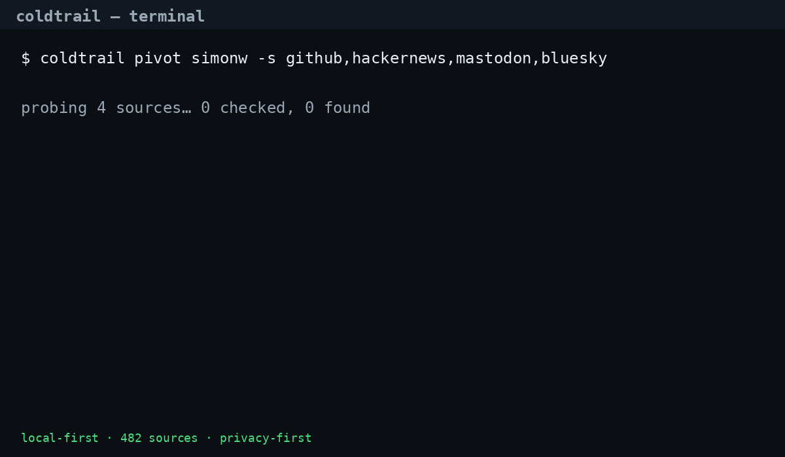
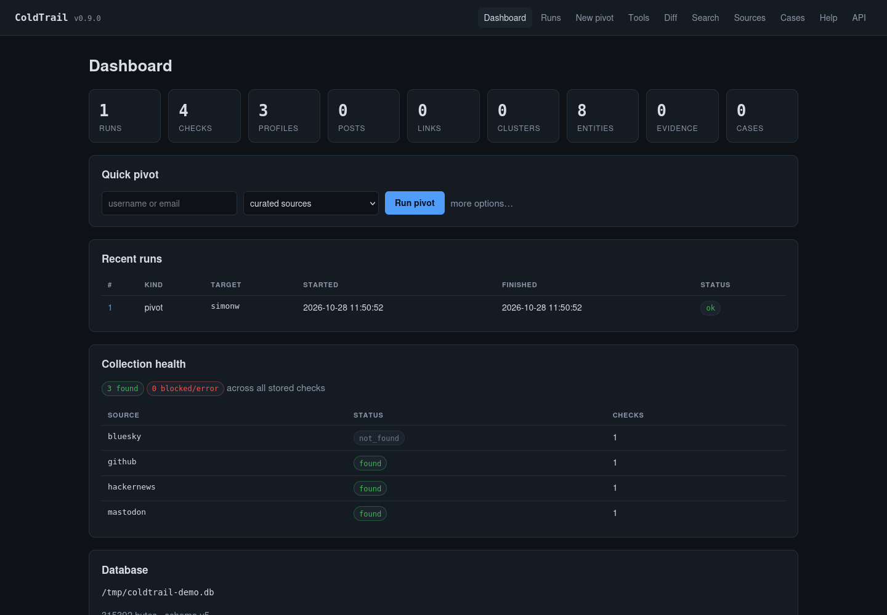

# ColdTrail

**Local-first OSINT toolkit for usernames, emails, and public profiles.**
Pivot across 482 sources, harvest profiles and posts into SQLite, correlate identities, and export
evidence-grade dossiers — from a CLI, a TUI, or a local web UI.

[](#verification)
[](LICENSE)
[](https://www.python.org/)
[](docs/index.html)





## Quickstart

```bash
git clone https://github.com/slopmanufacturer/coldtrail
cd coldtrail
uv sync

uv run coldtrail pivot alice          # curated sources + correlation
uv run coldtrail pivot alice --web    # add the 432-site web corpus
uv run coldtrail serve --open         # local web UI at 127.0.0.1:8765
uv run coldtrail tui                  # terminal UI
```

No API keys are required for most sources. Optional keys unlock more coverage:

```bash
export GITHUB_TOKEN=...        # higher GitHub rate limits
export HIBP_API_KEY=...        # Have I Been Pwned
export EMAILREP_API_KEY=...
export HUNTER_API_KEY=...      # Hunter.io email verification
export X_BEARER_TOKEN=...      # X/Twitter API v2
```

## Who it's for

- **Journalists and researchers** who need a reproducible trail from a handle or email.
- **Threat-intelligence and defensive teams** correlating public personas and exposure.
- **Brand-protection and due-diligence analysts** who need evidence, not just a list of links.
- **OSINT learners** who want one local database instead of a browser full of tabs.

Use it only for authorized research, public data, and lawful scope.

## What you get

| Capability | Details |
| --- | --- |
| **Pivot** | 482 sources (50 curated sources + 432 declarative sites), handle/email variants, multi-hop expansion |
| **Harvest** | Profiles, paginated posts, follow graphs, incremental cursors, profile-change history |
| **Correlate** | Additive scoring, calibrated confidence, Jaro-Winkler handle similarity, clusters |
| **Investigate** | Domain/IP/phone, RDAP, DNS, crt.sh, TLS, BGP/ASN, Wayback, dorks, breach metadata |
| **Collect evidence** | Content-addressed SHA-256 blobs, case dossiers, tags, notes, audit log |
| **Export** | JSON, JSONL, CSV, GraphML, GEXF, DOT, HTML, Markdown, STIX 2.1, Maltego |
| **Automate** | `batch`, `watch`, `recluster`, `diff`, JSON output everywhere |

### Three interfaces, one database

- **CLI** — scriptable Typer app with grouped help and JSON/JSONL output.
- **TUI** — Textual console with dashboard, live pivot rows, browse/search, cases, tools.
- **Web** — FastAPI app with JSON API, SSE-streamed pivots, interactive identity graph,
  OSINT workbench, run diffing, case dossiers, evidence downloads, optional auth.

```bash
uv run coldtrail --help
uv run coldtrail serve --token "$(openssl rand -hex 24)"   # shared-token auth
```

## How it compares

Based on public documentation, not a benchmark. Check each upstream project for current features.

| | ColdTrail | Sherlock | Maigret | theHarvester | SpiderFoot | Maltego |
| --- | --- | --- | --- | --- | --- | --- |
| Username pivot | yes (482 sources) | yes | yes | partial | partial | via transforms |
| Email pivot | yes | no | partial | yes | yes | via transforms |
| Local database | SQLite | no | reports | no | SQLite | commercial graph |
| Identity correlation | yes | no | partial | no | partial | yes (manual) |
| Evidence store | yes (SHA-256) | no | no | no | partial | commercial |
| Built-in TUI | yes | no | no | no | no | no |
| Local web UI | yes | no | no | no | yes | desktop app |
| STIX/Maltego export | yes | no | partial | no | partial | yes |
| Privacy-first defaults | yes | n/a | n/a | n/a | partial | commercial |
| License | MIT | MIT | MIT | GPL | MIT | commercial |

## Performance

Network-bound and source-dependent; these are the design targets and historical measurements
from the 0.5.2 release notes on a laptop:

| Scenario | Cold | Warm cache |
| --- | --- | --- |
| Curated pivot (≈42 checks) | ~4s | ~2s |
| Web corpus (≈471 checks) | ~22s | ~15s |

Reproduce locally:

```bash
time uv run coldtrail pivot alice --web --no-save
time uv run coldtrail pivot alice --no-save          # warm cache
```

## Privacy first

ColdTrail is designed to keep investigations on your machine.

- **No telemetry.** No analytics, crash reporting, update checks, or phone-home. The only
  outbound requests are the sources and tools you explicitly run. `doctor --offline` skips
  even its reachability probe.
- **Local storage, owner-only.** SQLite, WAL/SHM, and evidence blobs are created `0600`;
  evidence directories are `0700`. There is no cloud backend.
- **Raw bodies are opt-in.** Normal runs do not retain raw HTTP responses. Use `--raw` only
  when you need replay or contract fixtures.
- **No third-party images by default.** Avatar hashing (`--avatar-hash`) downloads profile
  images from source platforms, so it is off unless you ask for it.
- **Sensitive identifiers stay out of indexes.** Email targets are SHA-256 hashed in
  cache/raw keys, and API keys are never written to those keys. HIBP, EmailRep, and Hunter
  use auth headers; Shodan's key is sent over TLS and redacted locally.
- **Tor without DNS leaks.** `--tor` uses `socks5h://127.0.0.1:9050` (remote DNS).
  `--proxy` supports HTTP/SOCKS proxies.
- **Web UI is local and locked down.** Binds `127.0.0.1`; non-loopback binds require
  `--token` (or an explicit `--allow-unauthenticated`); cookies are HMAC-derived; CSP,
  `Referrer-Policy: no-referrer`, `Cache-Control: no-store`, and no third-party assets.
- **Redaction and encryption.** Exports support `--redact`; encrypted exports use
  PBKDF2 + Fernet.
- **Retention.** `--retention-days N` or `prune --days N` removes old runs, raw/cache rows,
  audit entries, and orphan evidence blobs.
- **Breach data is metadata-only.** HIBP/HudsonRock/LeakCheck report exposure; Pwned
  Passwords uses k-anonymity and never sends the password or full hash.

**Limits:** every source you probe receives the target — that is inherent to OSINT. The
database is not encrypted at rest by default, so use full-disk encryption on shared
machines. `--raw` and the local HTTP cache can retain third-party content. See
[SECURITY.md](SECURITY.md) and the [privacy page](docs/privacy.html).

## External tools

Already installed tools are detected and can be imported into the same database:

```bash
uv run coldtrail integrations                  # status + install hints
uv run coldtrail run maigret alice --json      # import findings
uv run coldtrail ingest spiderfoot.json        # auto-detect format
```

| Category | Tools |
| --- | --- |
| Username | `sherlock`, `maigret`, `naminter` (WhatsMyName), `social-analyzer`, `blackbird` |
| Email | `holehe`, `h8mail`, `ghunt` |
| Social | `instaloader` (Instagram), `twscrape` (X/Twitter) |
| Infrastructure | `theHarvester`, `subfinder`, `whois`, `dig`, `nmap` |
| Files/media | `exiftool`, `yt-dlp` |
| Import-only | SpiderFoot JSON, Maltego CSV, theHarvester JSON, generic JSON |

Every runner uses an argument vector (never a shell) and rejects option-like targets.

## Documentation

- **Site:** [docs/index.html](docs/index.html) (GitHub Pages after launch)
- **Quickstart:** [docs/quickstart.html](docs/quickstart.html)
- **Coverage:** [docs/sources.html](docs/sources.html)
- **Comparison:** [docs/comparison.html](docs/comparison.html)
- **Privacy:** [docs/privacy.html](docs/privacy.html)
- **Security policy:** [SECURITY.md](SECURITY.md)
- **Contributing:** [CONTRIBUTING.md](CONTRIBUTING.md)
- **Launch checklist:** [LAUNCH.md](LAUNCH.md)
- **Changelog:** [CHANGELOG.md](CHANGELOG.md)

## Safety and legal

ColdTrail collects **public data only** and is built for authorized research,
journalism, threat intelligence, and defensive security. You are responsible for
applicable law, platform terms, and scope authorization.

- Default bind is `127.0.0.1`; the web UI has no auth unless `--token` is set.
- Non-loopback binds are refused without a token unless you explicitly override.
- Rate limiting and pacing are on by default; `--respect-robots` is available.
- Breach features are lookup-only metadata; they never retrieve or crack credentials.
- Pwned Passwords uses k-anonymity and never sends the password or full hash.
- Privacy guarantees and their limits are documented in **Privacy first** above and in
  [SECURITY.md](SECURITY.md).

## Verification

```bash
uv run pytest                  # 479 tests, no network (respx/TestClient/Textual pilot)
uv run ruff check .
uv run ruff format --check .
uv run coldtrail doctor --offline
```

## Development

Python 3.11+, `uv`, `src/` layout. Tests never hit the network; source contracts replay
recorded fixtures. See [CONTRIBUTING.md](CONTRIBUTING.md) for the workflow and
[AGENTS.md](AGENTS.md) for architecture and invariants.

```
src/coldtrail/
  cli/  tui/  web/  store/  sources/
  pivot.py  harvest.py  correlate.py  report.py  http.py  evidence.py
tests/   offline suite + contract fixtures
docs/    GitHub Pages site (sitemap, robots, privacy, comparison)
```

## License

MIT. The declarative corpus is generated from the
[Sherlock](https://github.com/sherlock-project/sherlock) dataset (MIT); see
`src/coldtrail/data/sites.toml` for the pinned ref and checksum.
